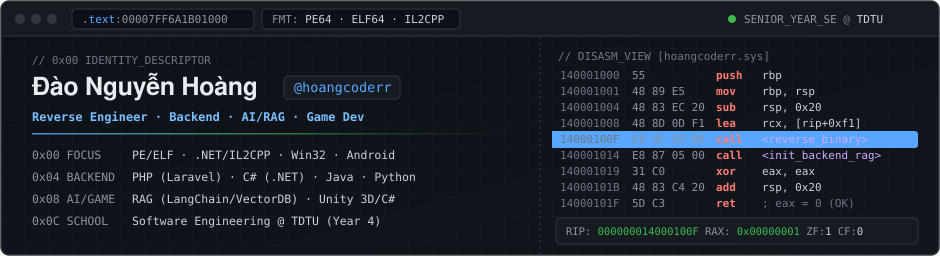
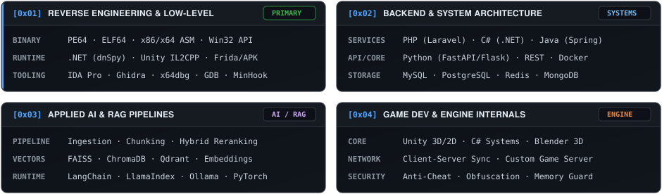

  

  
  
  
  

 

  

---

### `0x01` — Technical Stack

| Layer | Technologies & Tools |
| :--- | :--- |
| **Low-Level & Languages** |         |
| **Reverse Engineering** |             |
| **Backend & Databases** |          |
| **AI & RAG Systems** |      |
| **Game & Infrastructure** |         |

---

### `0x02` — Telemetry & Activity

  
  

  

  <picture>
    <source media="(prefers-color-scheme: dark)" srcset="https://raw.githubusercontent.com/hoangcoderr/hoangcoderr/output/github-contribution-grid-snake-dark.svg" />
    <source media="(prefers-color-scheme: light)" srcset="https://raw.githubusercontent.com/hoangcoderr/hoangcoderr/output/github-contribution-grid-snake.svg" />
    
  </picture>

---

### `0x03` — Channels & Support

  
  
  
  
  
  
  

